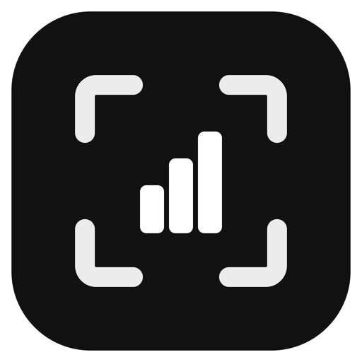

<p align="center">
  
</p>

<h1 align="center">Studio Focus</h1>

<p align="center">
  <b>Check your channel. Skip the feed.</b><br>
  A browser extension for YouTube creators that covers everything on YouTube with a white page, except the places where you run your channels.
</p>

<p align="center">
  <a href="https://studio-focus.suenot.com">Website</a> ·
  <a href="#install">Install</a> ·
  <a href="#how-it-works">How it works</a> ·
  <a href="LICENSE">MIT</a>
</p>

<p align="center">
  
</p>

## Why

You open YouTube to look at your analytics or reply to a comment. The home feed shows a video you want to watch. An hour later you are still there.

Studio Focus removes the temptation without removing access to your work. The feed, watch pages, Shorts and search are hidden behind a plain white page. Studio, the channel switcher and your own channels stay one click away.

## How it works

1. You open `youtube.com`.
2. The extension checks the address. If it is not on the allowed list, a white page covers the tab and any playing video is paused.
3. The white page offers shortcuts: YouTube Studio, the channel switcher and every channel you listed.
4. In Studio nothing is covered. You work there as usual.

| Page | What happens |
| --- | --- |
| `studio.youtube.com` (Studio, analytics, content, comments) | Always open |
| `/channel_switcher`, `/account` | Open, so you can switch between your channels |
| Your channels from the popup (`@handle` or channel ID) | Open |
| Home feed, watch pages, Shorts, search, other channels | Covered in white, video paused |
| `music.youtube.com`, `m.youtube.com` | Covered in white |

Need a page for a minute? Press "Unlock for 5 minutes" on the white page. Unlocks are counted: you get a limited number per day (3 by default, set it in the popup, 0 means never). The page shows how many are left, and when they run out the button is disabled until tomorrow. Pausing for 15 minutes from the popup spends one unlock too.

## Install

From source, until the store listing is live:

1. Clone this repository.
2. Open `chrome://extensions` and turn on Developer mode.
3. Click "Load unpacked" and pick the repository folder.

Works in Chrome, Edge, Brave and other Chromium browsers (Manifest V3).

**Firefox (121+):** open `about:debugging#/runtime/this-firefox`, click "Load Temporary Add-on" and pick `manifest.json`. The add-on stays until Firefox restarts; a permanent install needs a signed build from addons.mozilla.org.

## Setup

Click the toolbar icon. Set "Unlocks per day" and add your channels, one per line. Accepted forms: `@handle`, a channel ID (`UC...`) or a youtube.com URL. Channels are optional: Studio and the channel switcher work without them.

## Privacy

No network requests, no analytics, no remote code. Settings live in `chrome.storage.local` on your device. The only permission is `storage`.

## Project layout

```
manifest.json   Manifest V3
content.js      overlay logic, runs on youtube.com (not on Studio)
popup.html/js/css   toolbar popup: on/off, pause, your channels
icons/          extension icons
docs/           hero.svg (README demo), avatar.svg and avatar.png (same as icons/icon.svg)
```

## Contributing

Issues and pull requests are welcome. The extension is small on purpose: keep it dependency-free.

## License

MIT
